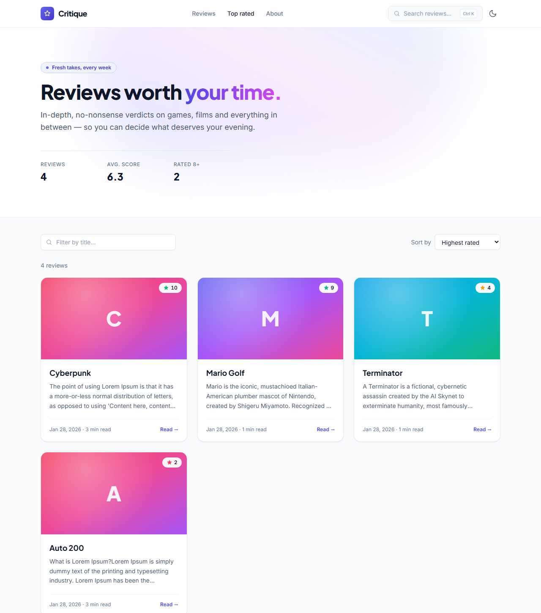
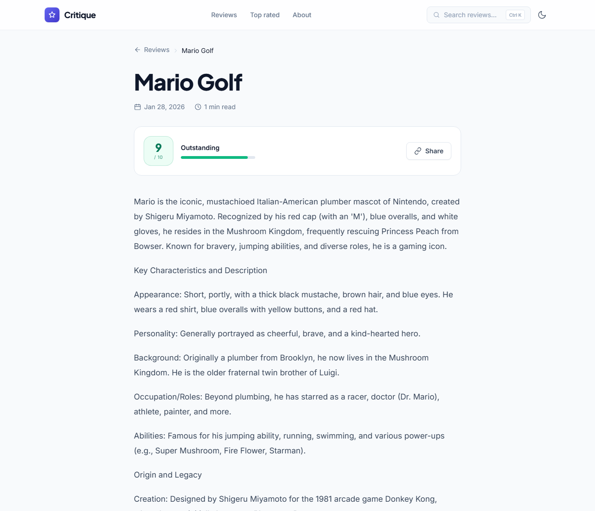
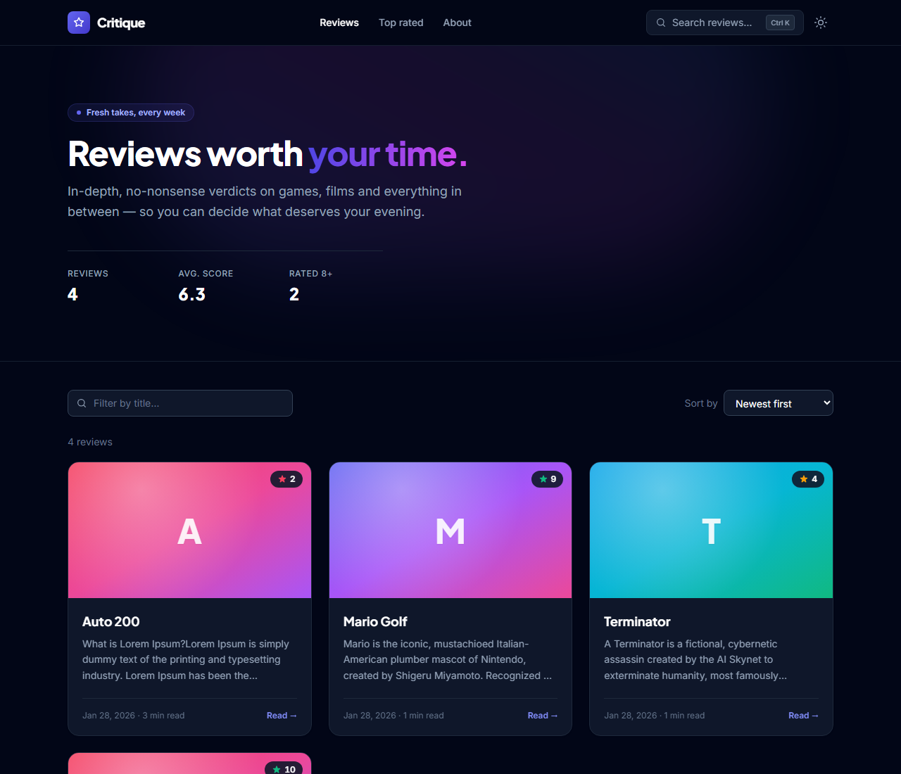

# React Strapi 5 GraphQL Reviews

A modern, type-safe review site built with **React** and **TypeScript**. Content is managed in **Strapi 5** and delivered over **GraphQL** with server-side search, filtering, sorting and pagination.

## 🚀 Features

### Frontend

- **Review listing** with hero stats (total reviews, average score, 8+ rated), cover images and reading time.
- **Server-side search, category filters, sorting and pagination** via `reviews_connection` — all state lives in the URL, so every view is shareable and works with the back button.
- **Quick search palette** (`Ctrl + K` / `⌘ + K`) with live results and full keyboard navigation.
- **Full Strapi Blocks renderer** — headings, lists (incl. nested), quotes, code, images, links and inline formatting, with unsafe link schemes filtered out.
- **Review page** with breadcrumb, color-coded score panel, verdict box, reading progress bar, share/copy-link button and related reviews from the same category.
- **Dark mode** that follows the system setting until the user picks a theme (no flash on load).
- **Polished states**: skeleton loaders, empty states, retryable error states and a 404 page.
- **Accessibility**: skip link, focus-visible rings, ARIA labels for search, pagination and rating meter.
- **About page** describing the scoring scale.

### Backend

- **Category** collection type with a many-to-many relation to reviews.
- Optional **cover image** on each review.
- **Automatic public permissions** — on startup, `bootstrap` grants the Public role read access (`find` / `findOne`) to reviews, categories and uploads, so the frontend works without manual setup.
- GraphQL configured with sensible `defaultLimit`, `maxLimit` and `depthLimit`.

## 📂 Project Structure

```text
react-strapi-graphql-site/
├── backend/                         # Strapi 5 headless CMS
│   ├── config/
│   │   ├── plugins.ts               # GraphQL plugin configuration
│   │   └── ...                      # admin, api, database, middlewares, server
│   ├── src/
│   │   ├── api/
│   │   │   ├── review/              # Review: title, rating, body (Blocks), cover, categories
│   │   │   └── category/            # Category: name, slug, reviews
│   │   └── index.ts                 # Bootstrap: grants public read permissions
│   └── types/generated/             # Auto-generated TypeScript types
│
├── frontend/                        # React + TypeScript frontend
│   ├── public/index.html            # Fonts, meta tags, theme bootstrap script
│   ├── src/
│   │   ├── components/
│   │   │   ├── BlocksRenderer.tsx   # Strapi Blocks → React
│   │   │   ├── CoverImage.tsx       # Cover with gradient fallback
│   │   │   ├── Pagination.tsx
│   │   │   ├── RatingBadge.tsx      # Score pill + score panel
│   │   │   ├── ReadingProgress.tsx
│   │   │   ├── ReviewCard.tsx       # Card + skeleton
│   │   │   ├── SearchDialog.tsx     # Ctrl/⌘ + K search palette
│   │   │   ├── ShareButton.tsx
│   │   │   ├── SiteHeader.tsx
│   │   │   ├── SiteFooter.tsx
│   │   │   ├── StateMessage.tsx     # Empty / error states
│   │   │   └── icons.tsx
│   │   ├── graphql/queries.ts       # Fragments and queries
│   │   ├── hooks/                   # useDebounce, useDocumentTitle, useTheme
│   │   ├── lib/format.ts            # Excerpts, reading time, dates, media URLs, rating tones
│   │   ├── pages/                   # Homepage, ReviewDetails, About, NotFound
│   │   ├── types/review.ts          # Content + Blocks types
│   │   ├── config.ts                # Site name, Strapi URL, page size
│   │   └── App.tsx                  # Routes and layout
│   ├── .env.example
│   └── tailwind.config.js           # Brand colors, fonts, dark mode
│
└── README.md
```

## 🛠️ Tech Stack

- **Frontend:** React 19, TypeScript, React Router 7, Tailwind CSS
- **API Client:** Apollo Client 4 (GraphQL)
- **Backend:** [Strapi 5](https://strapi.io/) with the GraphQL plugin
- **Content:** Strapi Blocks (rich text), Media Library

## 📦 Getting Started

> Strapi 5 supports Node.js **20–24**. Use one of those versions (e.g. via `nvm`) for the backend.

### 1. Backend (Strapi)

```bash
cd backend
cp .env.example .env     # then fill in the secrets
npm install
npm run develop
```

Open the admin panel at `http://localhost:1337/admin`, then:

1. Create a few **Categories** (e.g. _Games_, _Movies_, _Tech_).
2. Edit your **Reviews** — assign categories and (optionally) upload a cover image.

Public read permissions are granted automatically on startup — no need to configure roles by hand.

### 2. Frontend (React)

```bash
cd frontend
cp .env.example .env     # optional — defaults to http://localhost:1337
npm install
npm start
```

| Variable               | Default                 | Description                       |
| ---------------------- | ----------------------- | --------------------------------- |
| `REACT_APP_STRAPI_URL` | `http://localhost:1337` | Base URL of the Strapi server     |

## 📑 Content Model

**Review**

| Field        | Type          | Description                        |
| ------------ | ------------- | ---------------------------------- |
| `documentId` | ID!           | Unique document identifier.        |
| `title`      | String!       | Review title (unique).             |
| `rating`     | Int!          | Score from 1 to 10.                |
| `body`       | JSON!         | Strapi Blocks rich text.           |
| `cover`      | Media         | Optional cover image.              |
| `categories` | [Category]    | Many-to-many relation.             |

**Category**

| Field     | Type       | Description                    |
| --------- | ---------- | ------------------------------ |
| `name`    | String!    | Display name (unique).         |
| `slug`    | UID!       | URL-friendly identifier.       |
| `reviews` | [Review]   | Reviews in this category.      |

## 📡 Example Query

The listing uses Strapi's connection query for server-side filtering and pagination:

```graphql
query GetReviews($filters: ReviewFiltersInput, $sort: [String], $pagination: PaginationArg) {
  reviews_connection(filters: $filters, sort: $sort, pagination: $pagination) {
    nodes {
      documentId
      title
      rating
      body
      publishedAt
      cover { url alternativeText width height }
      categories { documentId name slug }
    }
    pageInfo { page pageSize pageCount total }
  }
}
```

```json
{
  "filters": { "title": { "containsi": "mario" }, "categories": { "slug": { "eq": "games" } } },
  "sort": ["rating:desc"],
  "pagination": { "page": 1, "pageSize": 9 }
}
```

## 🔧 Scripts (frontend)

- `npm start` — runs the app in development mode.
- `npm run build` — creates an optimized production build.
- `npm test` — runs unit tests (formatting helpers, pagination).

## 🖼️ Screenshots





## 📄 License

Distributed under the MIT License.
